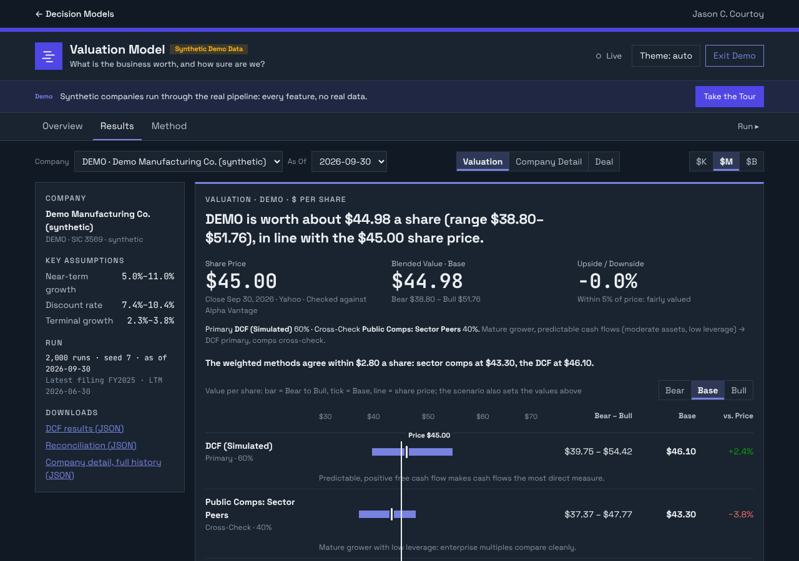
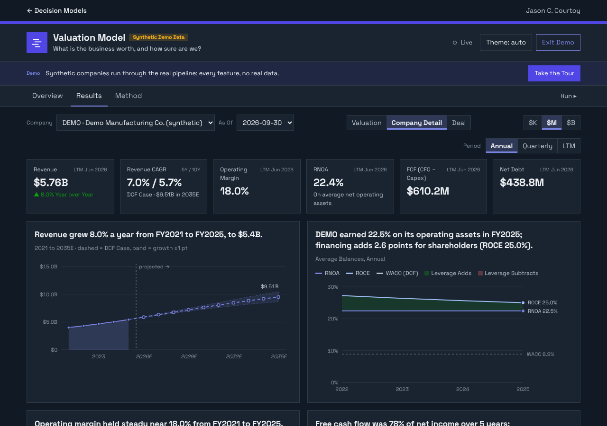
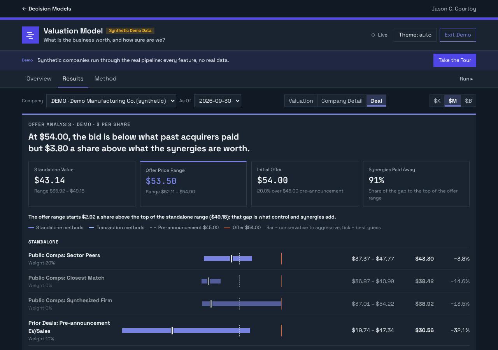
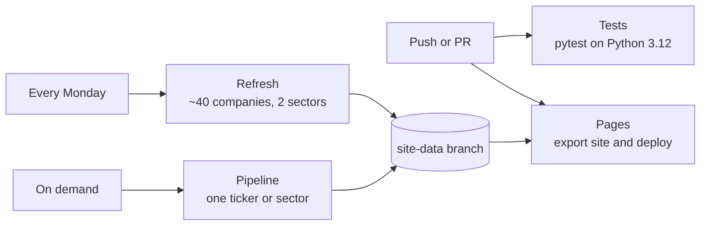

# Valuation Model

*What is the business worth, and how sure are we?* Part of **[Decision Models](https://courtizy.github.io/)** by Jason C. Courtoy.

[](https://github.com/Courtizy/valuation/actions/workflows/tests.yml)
[](https://github.com/Courtizy/valuation/actions/workflows/pages.yml)


**[Open the model](https://courtizy.github.io/valuation/)** · **[Guided demo](https://courtizy.github.io/valuation/?demo=1)** · [Architecture](docs/architecture.md) · [Changelog](CHANGELOG.md)

The Valuation Model values a public company from its SEC filings and shows how far the answer can move. It rebuilds the financial statements as they stood on a chosen date, analyzes them, runs a simulated DCF, prices the company against peers and past deals, and lines every method up on one football field that explains why they differ. An automated pipeline builds the published companies from SEC data, and the same Python engine runs in your browser on GitHub Pages. It is analysis of method, not investment advice.



## At a glance

| | |
|---|---|
| **Answer it gives** | A value range per share from several methods, the weight each one carries and why, and what moves the answer most |
| **Data** | SEC EDGAR filings (XBRL company facts), FRED Treasury yields, Damodaran's published industry betas and equity risk premium |
| **Engine** | Python, standard library only at runtime, seeded and reproducible |
| **Pipeline** | Four GitHub Actions workflows: tests on every push, a weekly refresh of about 40 companies, on-demand runs, and the Pages deploy |
| **Tests** | About 280 tests across 26 files, covering every layer on offline fixtures, plus architecture rules enforced as tests |
| **Site** | Static GitHub Pages app; runs any SEC filer in the browser through Pyodide; synthetic demo with a guided tour |

## What you can do with it

- **Read a company's financials as of any date.** Only facts filed on or before the as-of date count, so a past valuation can be rerun exactly as it would have looked then. Statements come in annual, quarterly and trailing-twelve-month views, with data checks against a second source.
- **Analyze the statements three ways.** Standard ratios (DuPont, leverage, Altman Z), working-capital ratios (operating and cash conversion cycles), and reformulated operating vs. financing ratios (RNOA, ROCE, economic value added). Each framework shows where the company sits among its sector's quartiles.
- **Value it with a simulated DCF.** A three-statement projection feeds a firm DCF that is rerun 2,000 times. You see the spread of outcomes, a sensitivity grid, a tornado of the inputs that matter most, and checks on the terminal value.
- **Price it against public peers.** Comps run on sector peers picked by size and on the closest match on fundamentals, with each peer rated on how close it is.
- **Look at it as a deal.** Enter synergies and an offer. The model values the target with synergies, prices it against an uploaded list of prior deals, and compares the standalone range with the offer range.
- **Compare everything on one football field.** Methods are weighted by the company's profile, and every weight comes with a reason.
- **Run any company yourself.** The Run page values any SEC filer in your browser with no account or token. Results stay on your device.

<table>
<tr>
<td width="50%"></td>
<td width="50%"></td>
</tr>
<tr>
<td><sub>Company Detail: statements, ratios and sector benchmarks, each chart titled with what it shows.</sub></td>
<td><sub>Deal: standalone value against the offer range, with synergy and precedent methods.</sub></td>
</tr>
</table>

## Architecture

The engine is four layers. Each layer reads and writes JSON files only, so every step can run, be tested and be inspected on its own.

```mermaid
flowchart LR
  subgraph Sources
    SEC[SEC EDGAR]
    FRED[FRED]
    DAM[Damodaran]
  end
  Sources --> L0[L0 Ingest<br/>one adapter per source]
  L0 -->|raw_filing.json| L1[L1 Company detail<br/>normalize · periods · ratios · profile]
  L1 -->|company_detail.json| M
  subgraph M[L2 Models]
    DCF[DCF, simulated]
    COMPS[Public comps]
    SYN[Synergies]
    PREC[Precedents]
    LBO[LBO, in development]
  end
  M -->|model_results/*.json| REC[Reconcile]
  REC -->|comparison.json| L3[L3 Site<br/>GitHub Pages]
```



| Layer | Does | Writes |
|---|---|---|
| **L0 Ingest** | Fetches and caches source data faithfully, with no interpretation | `raw_filing.json`, `raw_market.json` |
| **L1 Company detail** | Normalizes point in time, then builds period views, ratios, the company profile and sector screens | `canonical_statements.json`, `company_detail.json` |
| **L2 Models** | Each model forecasts, discounts and simulates on its own; reconcile reads only their result files | `model_results/{model}.json`, `comparison.json` |
| **L3 App** | Static site that renders the JSON and holds no model logic | `site/` |

Design rules, most of them enforced by tests:

- **Lineage on every file.** Each file from L1 on records `schema_version`, `as_of` and the SHA-256 of its inputs. Any run can be reproduced, and reconcile warns when two models used different versions of an input.
- **Models are isolated.** A model imports only `L2_models.base` and `_core/`, never another model. Reconcile imports no model at all.
- **Shared math lives in `_core/`** (projection, cost of capital, DCF, simulation, share dilution, deals, synergies). It imports nothing else from the package, so it can move into a shared library unchanged.
- **The site never does math.** Every number on the page comes from the engine. In the browser the same Python package runs under Pyodide in a web worker, and a small Cloudflare Worker relays requests to sources that block browser calls.
- **One engine, two front doors.** The public door publishes SEC, FRED and Damodaran data only. The private door (`app/run_private.py`) runs the same engine locally with market prices, writing only to a gitignored folder.

## Pipeline



- **Tests** run the full suite on every push and pull request.
- **Refresh** builds every company and sector in [`configs/public/universe.json`](configs/public/universe.json) each week, so new filings show up without anyone running anything.
- **Pipeline** builds one ticker or sector on demand, with the as-of date, models and stopping layer as inputs:

  ```bash
  gh workflow run pipeline.yml -f ticker=DELL -f models=dcf,comps -f stop_after=L2
  gh workflow run pipeline.yml -f sector=sector:technology
  ```

- **Pages** rebuilds the demo from the current code, exports the site and deploys it on each push to `main` and after each successful Refresh or Pipeline run.
- Published data lives on the `site-data` branch, replaced by a single commit on each save, so `main` stays code only and its history doesn't grow.
- The runner reuses a peer's company detail when it already exists for the same as-of date, stops at the first failed step and marks the rest skipped, and has a `--dry-run` that prints the plan.

## How the model is designed

The central idea is that **no single method decides the value.** Each method owns its forecast, cost of capital and range. Reconciliation then decides how much each one counts, based on what kind of company it is.

### Company detail

- **Normalization.** Each XBRL fact maps to a canonical line item through a concept registry with ranked tags. One tag wins per period, restatements are flagged, and the balance sheet, gross profit and net income identities must tie on every build.
- **Periods.** Quarterly is the base. Q4 is full year less the nine-month year to date, annual comes from 10-K values, and TTM sums four quarters. Balance-sheet items are never summed.
- **Company profile.** Four measured traits (growth stage, cash-flow predictability, asset intensity, capital structure), each with the rule that fired. These set the method weights later.

### Simulated DCF

- **Projection.** Revenue grows at a near-term rate that fades to terminal growth. Costs hold their ratios to sales, and working capital moves with sales at a ratio measured from the company's own history.
- **Discount rate.** Cost of equity from the 10-year Treasury, a beta unlevered at today's debt-to-equity and relevered at the target, and an equity risk premium. Options cover country risk, a synthetic credit rating from interest coverage, and private firms.
- **Value.** Free cash flow discounted at WACC, a growing-perpetuity terminal value, an enterprise-to-equity bridge, and diluted shares by the treasury stock method.
- **Simulation.** 2,000 seeded runs draw near-term growth, WACC and terminal growth from triangular distributions around the stated case. Bear and Bull are the 10th and 90th percentiles; the base case stays deterministic.
- **Implied mode.** Solves for the growth rate today's price implies.

### Public comparables

- EV/Sales, EV/EBITDA and P/E from each peer's own filings, positive multiples only, giving low, median and high implied prices.
- Each peer is rated against the target on the drivers a multiple stands in for (growth, discount rate, margin, leverage) and weighted by closeness. A third, synthesized peer set reweights peers to match the target.

### Deal analysis

- **Synergies.** Two views: the whole firm valued with synergies built into its growth and cost ratios, and the synergies valued on their own and added to the pre-announcement price. Both phase savings in, charge one-time integration costs, and test how much of the savings can last.
- **Precedent transactions.** Upload a deal list as CSV or paste it from Excel; a standard deal-database export works as is. The model computes premiums and deal multiples, implied values from the closest deals, central tendency across all of them, and a premium regression.
- **Offer summary.** Standalone range against offer range, with editable weights, the target's bargaining power, the premium and the share of synergies paid away.
- **LBO (in development).** What a financial sponsor could pay at a target return, with debt sized by collateral and interest coverage. It is scaffolded in the engine and on the Deal page and is still being built out and checked.

### Reconciliation

| Company profile | Primary method | Cross-check |
|---|---|---|
| Financial-style balance sheet | Comps (P/B, P/E) | DCF as reference |
| High growth or low predictability | Comps 60% | DCF 40% |
| Mature with predictable cash flow | DCF 60% | Comps 40% |
| Declining | DCF 50% | Comps 50% |

Methods that didn't run drop out and the rest renormalize. Precedents and synergy values carry weight in the acquisition view and are reference rows for a standalone value. A per-company file can override the weights.

## Testing and validation

| Check | Where it runs |
|---|---|
| Unit and integration tests for each layer, on recorded SEC, FRED, Damodaran and market fixtures (no network) | Every push and PR |
| End-to-end runner tests, from ingest through reconcile | Every push and PR |
| Model isolation and `_core/` independence, checked by import tests | Every push and PR |
| Seeded, reproducible simulation | Every push and PR |
| Statement identities tie on every normalization | Every pipeline run |
| Parity with reference spreadsheet models, to the cent | Locally (the workbooks aren't in the repo, so these 15 tests skip in CI) |

<details>
<summary>Running the parity tests</summary>

Copy `tests/course_cases.example.json` to `tests/course_cases.local.json` (gitignored), point each key at a workbook, then:

```bash
pip install -e ".[dev,export]"
VALUATION_COURSE_DIR=/path/to/workbooks pytest tests/test_course_parity.py
```

</details>

## Data and licensing

Only government data and Damodaran's openly published datasets reach the public site. Third-party market data is used in private runs or in the visitor's own browser, and is never committed or published.

| Source | Provides | Public site | Your browser / private runs |
|---|---|---|---|
| [SEC EDGAR](https://www.sec.gov/search-filings/edgar-application-programming-interfaces) | Statements, share counts, sector membership | Yes | Yes |
| [FRED](https://fred.stlouisfed.org/series/DGS10) (DGS10) | Risk-free rate | Yes | Yes |
| [Damodaran, NYU Stern](https://pages.stern.nyu.edu/~adamodar/New_Home_Page/datafile/Betas.html) | Industry betas, implied ERP | Yes, cited | Yes |
| Yahoo Finance (unofficial endpoints) | Prices, beta, gaps in the filings, cross-check | No | Yes |
| [Alpha Vantage](https://www.alphavantage.co/), [Finnhub](https://finnhub.io/) (your own key) | Backup prices, beta | No | Yes |

- SEC requests carry a contact User-Agent and stay within the fair-access limit of 10 requests a second.
- **Showcase mode**, the public default, never fetches market prices. If a run carried them, publish strips the prices and everything derived from them. Price-based outputs on the public site appear only in the synthetic demo.
- The repository ships code, configuration and the synthetic demo, not any third-party dataset.

## Quick start

```bash
pip install -e ".[dev]"
pytest -q
export SEC_USER_AGENT="Your Name you@example.com"         # the SEC requires contact details
python -m valuation run AAPL --stop-after L1               # data/AAPL/<today>/company_detail.json
python -m valuation run AAPL --models dcf,comps            # through L2 and reconcile
python -m valuation sector sector:technology               # a sector screen
python -m valuation.L3_app.publish --data-dir data --site-dir site
python scripts/export_site.py                              # brand, demo, changelog, engine bundle
python -m http.server -d site 8000                         # http://localhost:8000 (?demo=1 for the demo)
```

## Repository layout

| Path | Purpose |
|---|---|
| `src/valuation/` | The engine: `L0_ingest/`, `L1_detail/`, `L2_models/`, `L3_app/`, `runner/`, and `_core/` (shared math) |
| `configs/public/` | Hand-edited assumptions, comps peers, sector packs and taxonomy, and `universe.json` |
| `site/` | The GitHub Pages app (Overview, Results, Method, Run) |
| `worker/` | Cloudflare Worker proxy for runs in the browser |
| `scripts/` | Site export, weekly universe refresh, `site-data` branch helpers |
| `.github/workflows/` | Tests, Refresh, Pipeline, Pages |
| `app/`, `private/` | Private door; `private/` is gitignored |
| `tests/`, `docs/` | Tests per layer; a design doc per layer and model |

## Roadmap

1. Finish and check the LBO, then an IPO model.
2. Excel export: a live-formula DCF workbook per run, then comps.
3. Back-testing: score past DCF forecasts against what was later filed, using the as-of cutoff.
4. A one-page memo PDF per company.
5. Move `_core/` into the Shared Core package (`courtoy-core`).

## Docs

| Doc | Covers |
|---|---|
| [`docs/architecture.md`](docs/architecture.md) | Layers, data layout, cross-cutting rules |
| [`docs/L0_ingestor_design.md`](docs/L0_ingestor_design.md), [`docs/L0_market.md`](docs/L0_market.md) | SEC ingest; market data |
| [`docs/L1_concepts.md`](docs/L1_concepts.md), [`docs/L1_normalize.md`](docs/L1_normalize.md), [`docs/L1_build.md`](docs/L1_build.md), [`docs/L1_sector.md`](docs/L1_sector.md) | Concept registry, normalizer, period views and ratios, sector screens |
| [`docs/core_projection.md`](docs/core_projection.md) | Projection engine |
| [`docs/L2_dcf.md`](docs/L2_dcf.md), [`docs/L2_comps.md`](docs/L2_comps.md) | DCF and its simulation; public comps |
| [`docs/L2_synergy.md`](docs/L2_synergy.md), [`docs/L2_precedents.md`](docs/L2_precedents.md), [`docs/L2_lbo.md`](docs/L2_lbo.md) | Deal models |
| [`docs/L2_reconcile.md`](docs/L2_reconcile.md) | Profile-driven weighting |
| [`docs/L3_site.md`](docs/L3_site.md) | The site, workflows and setup |

## License

[Apache 2.0](LICENSE). Standard library only at runtime.

<sub>Personal project · public or synthetic data only · not endorsed by DoD or the U.S. Air Force · analysis of method, not investment advice.</sub>
